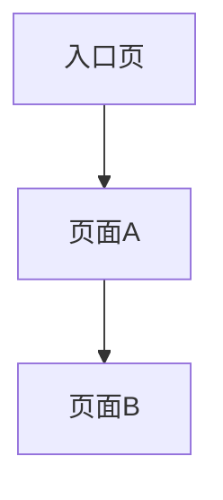

# Prototype Index

> 文件名建议：`prototype-index.md`  
> 用途：给 AI / Coding Agent 执行的页面级任务索引。  
> 原则：每次只执行一个页面或一个小模块，完成后回写状态。

---

## 1. 原型生成目标

| 项目 | 内容 |
|---|---|
| 产品 / 系统名称 |  |
| 原型目标 |  |
| 生成范围 |  |
| 技术栈 |  |
| UI 组件库 |  |
| 设计规范 |  |
| 项目目录 |  |
| 工作区模式 | standalone / prototype-starter-compatible |
| 根 DESIGN.md / design.md（可选） | 有 / 无 / 不适用 |
| 设计依据 | 设计文档 / Starter 现有样式；记录实际参考文件 |
| Starter 共享资产 | 有 / 无 / 不适用 |
| 工程复用依据 | 框架、组件库、布局、样式和代表性页面的实际路径 |
| 路由与菜单接入 | 实际配置路径、页面入口约定及原有页面与路由基线 |
| 接口与 Mock 约定 | 接口封装、类型、Mock 配置和数据样例的实际路径 |
| 工程验证命令 | 包管理器、启动、构建及适用检查命令 |
| Manifest 文件 | feature-manifest.json / 不适用 |
| 执行模式 | interactive / auto / review-first / strict / draft |

---

## 2. 执行规则

1. 每次只生成一个页面或一个小模块。
2. 生成页面前，必须读取当前 `prototype-index.md`。
3. 只执行状态为 `Not Started` 且无阻塞项的任务。
4. 如果任务状态为 `Needs Confirmation` 或 `Needs Input`，必须等待用户确认或补充。
5. 生成页面后，必须回写任务状态。
6. 生成页面后，必须记录生成文件。
7. 如果发现遗漏页面或交互，必须新增任务，并标记为 `Needs Confirmation`。
8. 不得私自删除 index 中的任务。
9. 在已有前端工程中，先读取项目约定、构建配置、路由、布局、公共样式、组件和 Mock 实现，直接沿用工程结构。设计文档、设计护栏和共享注册表存在时读取；缺少设计文档时沿用现有样式，不要求固定目录。
10. 仅在现有工具需要或用户要求时，根据已确认且无阻塞的任务生成 `feature-manifest.json`，格式以消费工具实际契约为准。
11. 有适用页面生成脚本时核对参数后使用；没有时参考已有页面手动创建，接通路由、菜单和现有 Mock 机制，保留原有页面与路由。
12. 所有任务完成后，必须执行完整性检查。
13. 原型应尽量保持可运行 / 可预览；按项目实际命令检查并验证关键 Mock 交互，记录结果和未验证项。

---

## 3. 页面任务清单

| Task ID | Function Module | Page Name | Page Type | Iteration Slug | Page Key | Surface | Parent Page Key | Source Section | Source Type | Previous Page | Trigger Operation | Next Page | Core Components | Key Fields | Required Route | Suggested File Path | Design Pattern Refs | Manifest Entry | Starter Compatible | Status | Check Result | Generated Files | Notes |
|---|---|---|---|---|---|---|---|---|---|---|---|---|---|---|---|---|---|---|---|---|---|---|---|
| T001 |  |  | Home / List / Create / Edit / Detail / Dialog / Drawer / Secondary Page / Result Page / Config Page |  |  | page / drawer / modal / side-panel / confirm |  |  | Explicit / Inferred from operation / Inferred from product pattern / Needs Confirmation / Needs Input |  |  |  |  |  | Yes / No |  |  | Yes / No | Yes / No | Not Started |  |  |  |

---

## 4. 页面关系图

---

## 5. 待确认任务

| Task ID | Page Name | Reason | Required User Decision | Default Suggestion |
|---|---|---|---|---|
|  |  |  |  |  |

---

## 6. 待补充信息

| Item ID | Missing Information | Affected Tasks | Default Handling | User Input |
|---|---|---|---|---|
|  |  |  |  |  |

---

## 7. 生成日志摘要

| Time | Task ID | Action | Result | Notes |
|---|---|---|---|---|
|  |  |  |  |  |

---

## 8. Manifest 映射

> 仅在需要生成 manifest 时填写，否则标记“不适用”。只纳入已确认且无 `Needs Confirmation` / `Needs Input` 阻塞的任务；字段适配消费工具契约。

| Task ID | Page Key | Surface | Parent Page Key | Manifest Path | Include In Manifest | Reason |
|---|---|---|---|---|---|---|
| T001 |  | page / drawer / modal / side-panel / confirm |  | feature-manifest.json | Yes / No |  |

---

## 9. Starter 兼容性要求

| 检查项 | 要求 | 当前状态 |
|---|---|---|
| 是否定位实际工程根目录 | 用户指定工程，或结合目标目录及其 prototype-starter/ 子目录中的项目资料和源码判断；不要求固定标志文件 | 已定位 / 待确定 / 不适用 |
| 是否读取根 DESIGN.md / design.md | 存在时读取，缺失不阻塞 | 已读取 / 未读取 / 不适用 |
| 缺少设计文档时是否沿用 Starter 样式 | 读取并复用共享样式、组件及已有页面或模板 | 已沿用 / 未沿用 / 不适用 |
| 是否读取 fidelity-guardrails | 存在时必须读取 | 已读取 / 未读取 / 不适用 |
| 是否读取 shared-registry | 存在时必须读取 | 已读取 / 未读取 / 不适用 |
| 是否生成 feature-manifest.json | 现有工具需要或用户要求时，index 确认后生成 | 已生成 / 未生成 / 不适用 |
| 是否使用生成脚本 | 适用时核对契约后使用；不存在时手动实现 | 已使用 / 手动实现 / 不适用 |
| 是否复用工程资源 | 复用实际公共样式、组件和布局，不限定 shared/ 路径 | 已复用 / 未复用 / 不适用 |
| 是否接入路由与 Mock | 沿用现有菜单、路由、接口封装和 Mock 机制 | 已接入 / 未接入 / 不适用 |
| 是否验证工程和交互 | 执行适用工程检查并验证关键 Mock 交互 | 已通过 / 未通过 / 未验证 / 不适用 |
| 是否运行 compliance | 存在适用脚本时运行 | 已运行 / 未运行 / 不适用 |
